# W02 · 林桂均（lgj）学习实录

> 本篇是本周作业的过程记录：当天备忘录原文 + 12 张操作截图，按时间顺序整理。
> 提炼后的说明文档见 [week2-notes.md](week2-notes.md)。

## 本周作业：AI + GitHub 闭环

1. **准备一个"自己的东西"**
   可以用 AI 做一个新的小东西（小网页 / 小游戏 / 命令行小工具 / 自动化脚本），也可以是自己以前的作业、项目、作品；题材不限。
2. **在个人 GitHub 建库并上传**
3. **用 teach skill 学 Linux**
4. **向团队仓库提 PR**

---

## 一、准备了什么：wedding 祝福代码

### 版本 1（wedding1.c）

只有四行，`printf("新婚快乐！\n")` 加 `return 0`。它的用途是确认环境没问题：如果这一步就报错，问题不在代码，而在编译器。

【屏幕上直接蹦出一行「新婚快乐！」，然后程序就退出了】

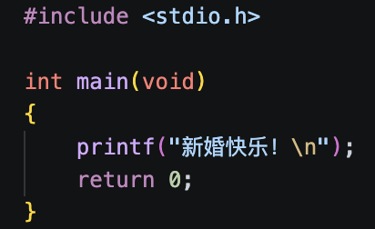

### 版本 2（wedding2.c）

把祝福语排成字符画，一行一行往下长。

【爱心从上到下逐行出现，长成一个完整的心，再打出「新 婚 快 乐」】

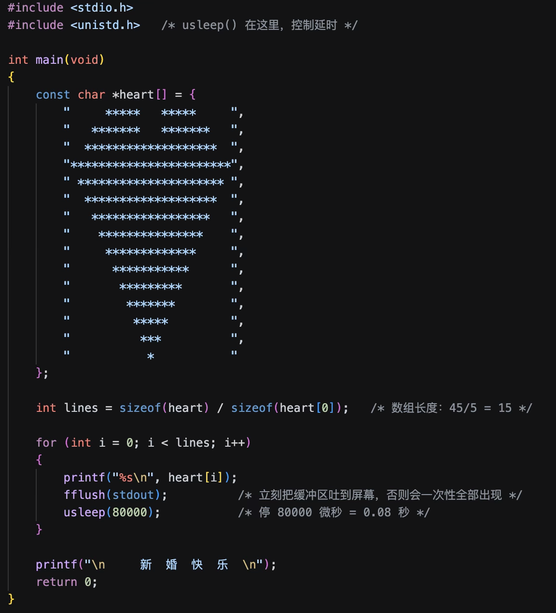

### 版本 3（wedding3.c）

第 5 章的实战：把两个动作拆成函数。

- `print_heart(int delay_ms)` 只管画心
- `type_text(const char *text, int delay_ms)` 只管一个字一个字打（靠 `text[i] != '\0'` 判断字符串到头）

`main` 里用 `srand(time(NULL))` 播种，然后抽 3 条不重复的祝福语。比如这次运行抽到「百年好合、永结同心、琴瑟和鸣」。

【爱心快速长出来 → 「新婚快乐！」像打字机一样一个字一个字蹦出 → 「愿你们：」→ 三条随机祝福语逐条弹出】

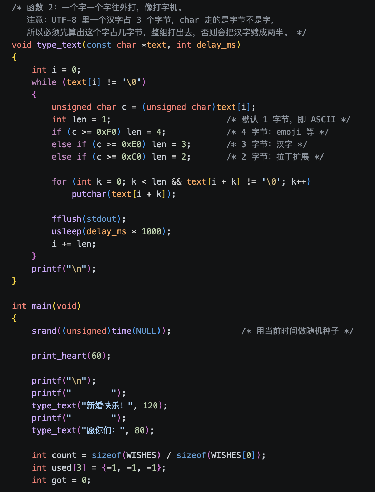

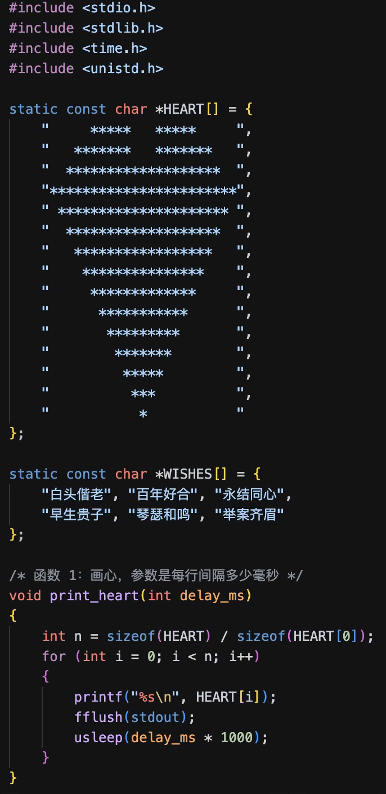

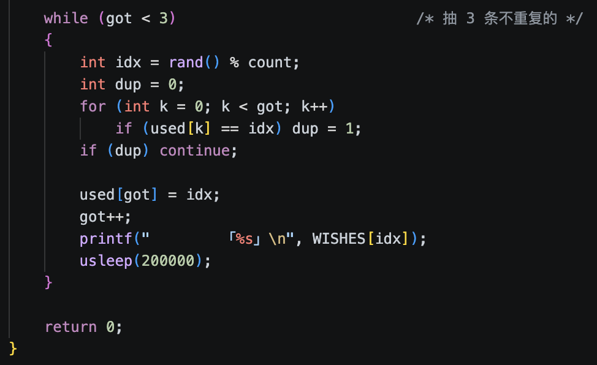

### 实操过程

**1. 在终端里新建文件夹并编译**

```bash
cd ~/WorkBuddy/2026-10-28-18-46-32/wedding/lesson
clang -Wall step1.c -o s1 && ./s1
```

**2. 用 VS Code 写代码**

打开文件夹、用英文命名（不可有空格，可用下划线代替）。

**3. 通过新建终端运行**

指令见上。编译参数逐个拆开看：

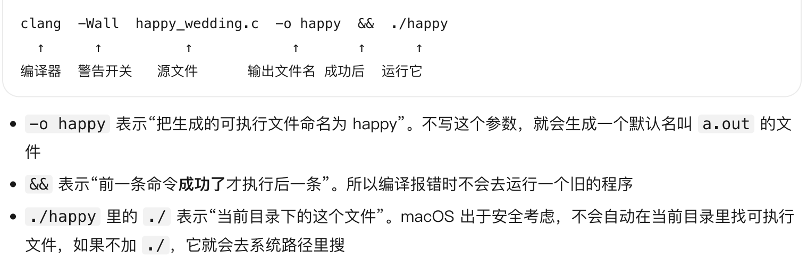

**4. 程序写完后 AI 给了复习清单**

见 [assets/wedding-review-checklist.md](assets/wedding-review-checklist.md)。

---

## 二、在个人 GitHub 建库并上传

新建一个仓库，把它传上去（网页版或本地 git 均可）。

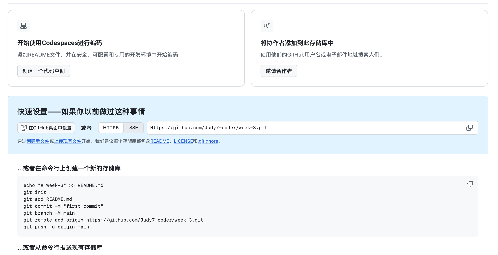

**终端要用 SSH 的地址**，不要用 HTTPS。

**为什么终端和网页要一起操作（在终端输入地址）？**

因为本地电脑和 GitHub 之间要靠地址建立联系——`git remote add origin` 就是在本地登记"我的东西该往哪儿送"。

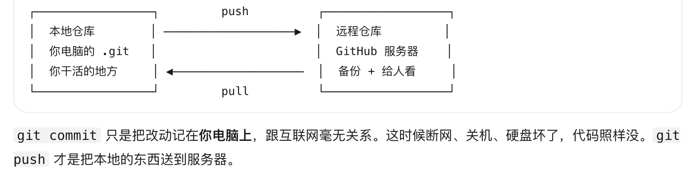

> `git commit` 只是把改动记在你电脑上，跟互联网毫无关系。这时候断网、关机、硬盘坏了，代码照样没。`git push` 才是把本地的东西送到服务器。

---

## 三、用 teach skill 学 Linux

给自己的 Agent 装上 `mattpocock/skills` 里的 teach skill，用它学一个 Linux 基础主题——**「在 Linux 上跑通一个程序需要做哪些事」**（装依赖、编译 / 解释执行、权限、路径、运行、排错）。

① 装 teach skill → ② 用它学 Linux（装好后开始）

### 1. 在终端装技能

```bash
mkdir -p ~/.workbuddy/skills          # 确认技能目录存在
git clone https://github.com/mattpocock/skills.git /tmp/mp-skills   # 仓库拉下来
cp -R /tmp/mp-skills/skills/productivity/teach ~/.workbuddy/skills/teach   # teach 拷进 workbuddy
ls ~/.workbuddy/skills/teach
rm -rf /tmp/mp-skills
```

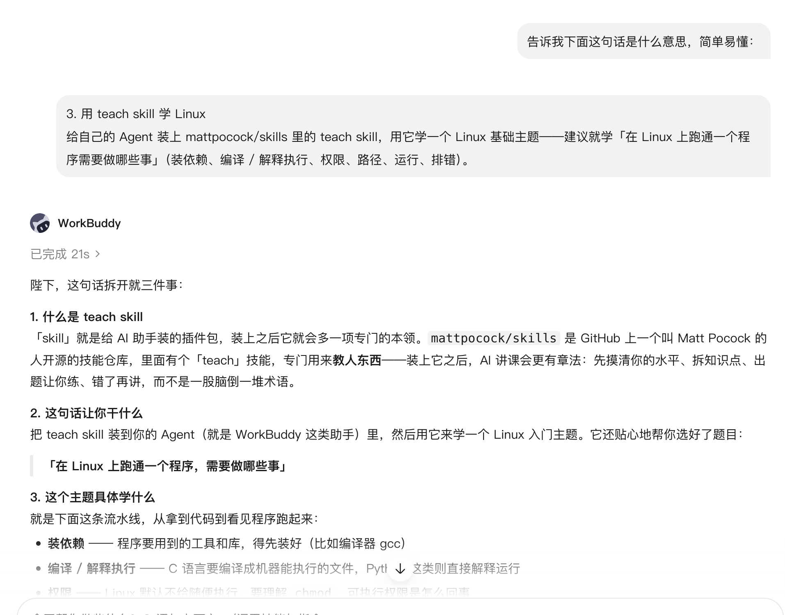

### 2. 新建一个独立文件夹

因为 teach skill 会把「你启动它时所在的那个目录」当成教学工作区，会往里写 `MISSION.md`、`RESOURCES.md`、`lessons/`、`learning-records/`——单独一个文件夹以防乱写。

```bash
mkdir -p ~/WorkBuddy/teach-linux
```

### 3. 新开会话，用 /teach 调用

提醒：**前提要先告诉它"把工作目录切换到 `~/WorkBuddy/teach-linux`"**（单独开一个文件夹，定位）。

开课申请的每一句都有来历：

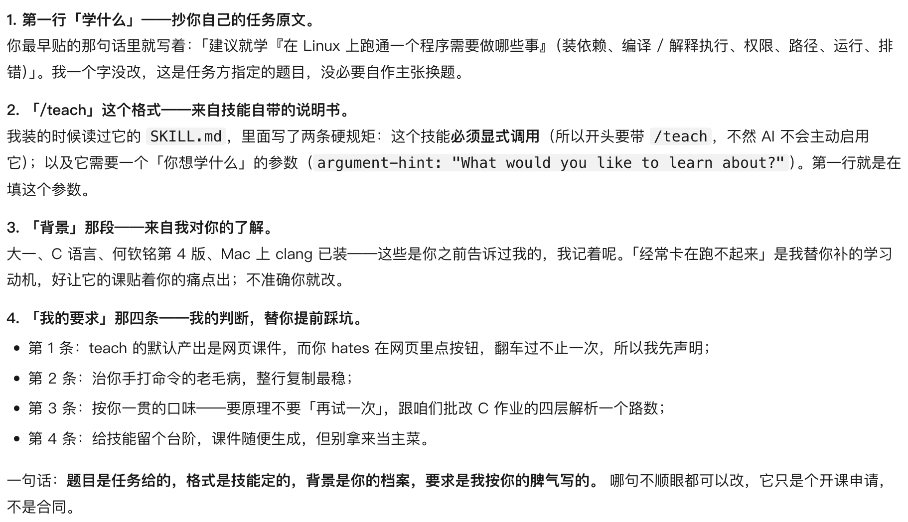

### 4. 和 Linux 接触

① 登录 → ② 建工作区 + 同一个 hello.c → ③ 编译（`gcc`）→ ④ 撞出四个差异 → ⑤ 顺手复核：同一套机制在 Linux 上照旧

**练习场（Mac 本地四阶段）**

```bash
mkdir -p ~/WorkBuddy/teach-linux/playground && cd ~/WorkBuddy/teach-linux/playground

cat > hello.c <<'EOF'
#include <stdio.h>
int main(void) {
    printf("hello\n");
    return 0;
}
EOF

clang -E hello.c -o hello.i   # 预处理：stdio.h 被整个展开塞进来
clang -S hello.i -o hello.s   # 编译：变成汇编，人还能勉强读
clang -c hello.s -o hello.o   # 汇编：变机器码，但此刻还跑不了
clang hello.o -o hello        # 链接：把 printf 的真身（在库里）补进来

./hello
file hello hello.o hello.s && ls -l hello
```

**Mac 和 Linux 的差异**：编译器（Mac 的 `gcc` 是 clang 的马甲，Linux 上才是真 gcc）、底层 C 库（Mac 是 libSystem，Linux 是 glibc）、内核（管家：Mac 是 XNU（BSD 血统），Linux 就是 Linux）。

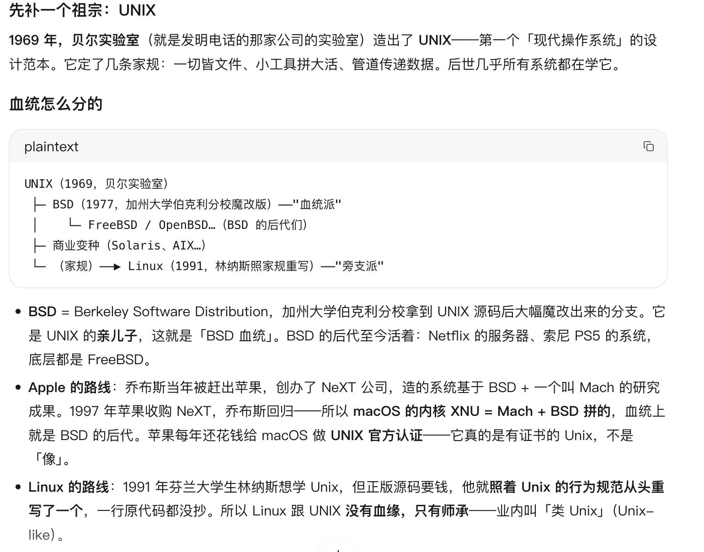

**Linux 的「装依赖」入口**：

```bash
dpkg -S /lib/x86_64-linux-gnu/libc.so.6 && apt-cache policy libc6 | head -3
```

### ⚠️ 踩的坑：把 shell 命令当成 C 代码喂给编译器

更改与补救：

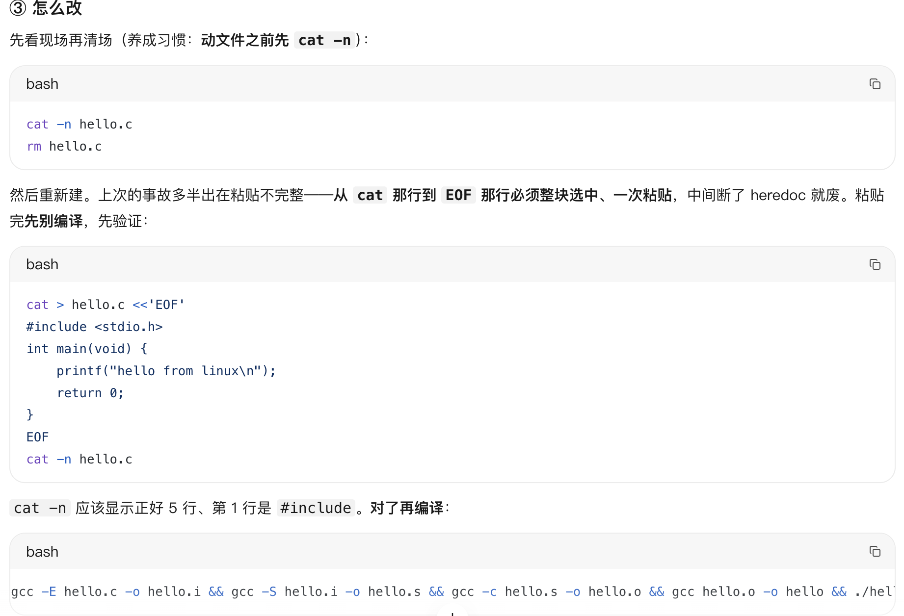

**教训**：粘贴 heredoc 必须从 `cat` 那行到 `EOF` 那行整块选中、一次粘贴，中间断了 heredoc 就废。

课件存档（HTML，可直接打开）：[一份代码是怎么变成「跑着的程序」的](assets/code-to-running-program.html)、[在真 Linux 上跑同一个程序](assets/same-program-on-linux.html)、[程序跑起来还缺什么](assets/what-program-needs.html)、[程序跑不同排查清单](assets/troubleshooting-checklist.html)。

---

## 四、向团队仓库提 PR

在 `W02/<你的缩写>/` 放一份说明文件（名字随意，按仓库规则用英文即可），写清两件事：

- **这周做了什么**：东西是什么、仓库链接、AI 帮了什么忙
- **学到了什么**：用 teach 学到的要点、自己的体会，以及以后怎么维护更新自己的 GitHub 账号、怎么给别人的仓库做贡献

**Fork** = 在 GitHub 网站上把别人的仓库一键复制一份到你自己的账号下（自己组织不需要）。

**流程**：直接 clone 组织仓库 → 开分支 → 放文件 → push → 网页提 PR

```bash
# ① 把草稿复制进仓库并打开编辑
cp ~/WorkBuddy/teach-linux/week2-lgj-draft.md W02/lgj/week2-notes.md && open W02/lgj/week2-notes.md

# ② 提交
git add W02/lgj/week2-notes.md && git commit -m "W02: lgj weekly notes (teach-linux lessons 1-3)"

# ③ 推上去
git push origin W02-lgj
```

④ 网页开 PR：https://github.com/HZCU-HPC-Team/group-meeting-2026-fall/pull/new/W02-lgj

---

## 附件

| 文件 | 说明 |
| --- | --- |
| [week2-notes.md](week2-notes.md) | 整理版说明文档（本次 PR 的主体） |
| [assets/week02-plain-explanation.md](assets/week02-plain-explanation.md) | W02 人话版讲解 |
| [assets/wedding-review-checklist.md](assets/wedding-review-checklist.md) | wedding 代码复习清单 |
| [assets/code-to-running-program.html](assets/code-to-running-program.html) | 课件：一份代码是怎么变成跑着的程序的 |
| [assets/same-program-on-linux.html](assets/same-program-on-linux.html) | 课件：在真 Linux 上跑同一个程序 |
| [assets/what-program-needs.html](assets/what-program-needs.html) | 课件：程序跑起来还缺什么 |
| [assets/troubleshooting-checklist.html](assets/troubleshooting-checklist.html) | 课件：程序跑不动的排查清单 |
